<div align="center">

# Workshop 1 — Analyse SAST avec SonarQube et Semgrep

**Intégration de l'analyse statique de sécurité (SAST) dans un pipeline CI/CD Jenkins**


</div>

Ce workshop met en place une chaîne d'analyse statique de sécurité (**SAST**) sur une application **Next.js / TypeScript** : à chaque `git push`, un webhook GitHub déclenche un pipeline **Jenkins** qui analyse le code avec **SonarQube** (qualité et sécurité, avec Quality Gate) et **Semgrep** (règles de sécurité), puis déploie l'application sur **Cloudflare Workers**. Jenkins et SonarQube tournent en conteneurs Docker sur une instance **Google Cloud**, provisionnée avec **Ansible** et exposée via un **Cloudflare Tunnel**.

**À la lecture de ce document, vous saurez :**

- ce qu'est le SAST et pourquoi on l'exécute avant le déploiement ;
- ce que SonarQube et Semgrep détectent, et en quoi ils se complètent ;
- comment l'infrastructure (GCP, Ansible, Docker, Cloudflare Tunnel) a été montée ;
- comment le pipeline Jenkins enchaîne analyse, Quality Gate et déploiement ;
- comment interpréter les résultats obtenus, et quelles sont leurs limites.

> **Note sur les preuves.** Toutes les captures de ce document sont des captures réelles de l'environnement du workshop. Les chiffres qui ne sont visibles dans aucune capture (notamment le bilan Semgrep) sont explicitement signalés comme **résultats rapportés**.

---

## Table des matières

- [1. Présentation académique](#1-présentation-académique)
- [2. Introduction et objectifs](#2-introduction-et-objectifs)
   - [2.1 Qu'est-ce que le SAST ?](#21-quest-ce-que-le-sast-)
   - [2.2 Pourquoi analyser avant le déploiement ?](#22-pourquoi-analyser-avant-le-déploiement-)
   - [2.3 Pourquoi l'intégrer au CI/CD ?](#23-pourquoi-lintégrer-au-cicd-)
   - [2.4 Rôle de chaque outil](#24-rôle-de-chaque-outil)
   - [2.5 Complémentarité SonarQube / Semgrep](#25-complémentarité-sonarqube--semgrep)
   - [2.6 Objectifs pédagogiques](#26-objectifs-pédagogiques)
- [3. Architecture du projet](#3-architecture-du-projet)
   - [3.1 Vue d'ensemble](#31-vue-densemble)
   - [3.2 Flux d'analyse SAST](#32-flux-danalyse-sast)
   - [3.3 Composants de l'infrastructure](#33-composants-de-linfrastructure)
- [4. Environnement et prérequis](#4-environnement-et-prérequis)
   - [4.1 Prérequis obligatoires](#41-prérequis-obligatoires)
   - [4.2 Prérequis optionnels (selon l'exposition et la cible de déploiement)](#42-prérequis-optionnels-selon-lexposition-et-la-cible-de-déploiement)
   - [4.3 Vérifier l'environnement](#43-vérifier-lenvironnement)
- [5. Installation et configuration](#5-installation-et-configuration)
   - [5.1 Création de l'instance Google Cloud](#51-création-de-linstance-google-cloud)
   - [5.2 Provisionnement avec Ansible](#52-provisionnement-avec-ansible)
   - [5.3 Exposition de Jenkins et SonarQube via Cloudflare Tunnel](#53-exposition-de-jenkins-et-sonarqube-via-cloudflare-tunnel)
   - [5.4 Configuration du webhook GitHub](#54-configuration-du-webhook-github)
   - [5.5 Configuration de Jenkins et gestion des secrets](#55-configuration-de-jenkins-et-gestion-des-secrets)
- [6. Analyse SonarQube](#6-analyse-sonarqube)
   - [6.1 Rôle et intégration](#61-rôle-et-intégration)
   - [6.2 Tableau de bord du projet](#62-tableau-de-bord-du-projet)
   - [6.3 Détail d'un problème de sécurité : règle `typescript:S2245`](#63-détail-dun-problème-de-sécurité--règle-typescripts2245)
   - [6.4 Problèmes de fiabilité visibles](#64-problèmes-de-fiabilité-visibles)
   - [6.5 Quality Gate](#65-quality-gate)
   - [6.6 Avertissement : base de données embarquée](#66-avertissement--base-de-données-embarquée)
- [7. Analyse Semgrep et pipeline Jenkins](#7-analyse-semgrep-et-pipeline-jenkins)
   - [7.1 Analyse Semgrep](#71-analyse-semgrep)
   - [7.2 Pipeline Jenkins](#72-pipeline-jenkins)
   - [7.3 Détail de l'étape Deploy](#73-détail-de-létape-deploy)
   - [7.4 Comportement en cas d'échec](#74-comportement-en-cas-déchec)
- [8. Résultats et comparaison](#8-résultats-et-comparaison)
   - [8.1 Synthèse](#81-synthèse)
   - [8.2 Problèmes SonarQube identifiés](#82-problèmes-sonarqube-identifiés)
   - [8.3 Comparaison des deux outils sur ce projet](#83-comparaison-des-deux-outils-sur-ce-projet)
- [9. Limites et recommandations](#9-limites-et-recommandations)
   - [9.1 Limites du SAST](#91-limites-du-sast)
   - [9.2 Limites propres à ce workshop](#92-limites-propres-à-ce-workshop)
   - [9.3 Recommandations pour ce projet](#93-recommandations-pour-ce-projet)
- [10. Conclusion](#10-conclusion)
- [11. Références](#11-références)

---

## 1. Présentation académique

| | |
|---|---|
| **Département** | Département Informatique |
| **Programme** | Master DevOps & Cloud Computing |
| **Workshop** | Workshop 1 — Analyse SAST avec SonarQube et Semgrep |
| **Réalisé par** | LAZRAG Khalid · ERAOUI Anass · BOUTEFAH KHATIB Fatima Zohra |
| **Responsable** | Pr. KOUISSI Mohamed |

---

## 2. Introduction et objectifs

### 2.1 Qu'est-ce que le SAST ?

Le **SAST** (*Static Application Security Testing*) consiste à analyser le **code source** d'une application **sans l'exécuter**, afin d'y repérer des motifs associés à des failles de sécurité (injections, cryptographie faible, secrets codés en dur, gestion d'erreurs dangereuse…) ou à des défauts de qualité qui peuvent en devenir.

### 2.2 Pourquoi analyser avant le déploiement ?

Plus un défaut est détecté tard, plus il coûte cher à corriger : en production, il faut le diagnostiquer, livrer un correctif en urgence et parfois gérer un incident. Détecté au moment du commit, il se corrige dans le contexte même où il a été écrit. C'est le principe du **« shift left »** : déplacer les contrôles de sécurité vers le début du cycle de développement.

### 2.3 Pourquoi l'intégrer au CI/CD ?

Une analyse lancée manuellement finit par être oubliée. Intégrée au pipeline, elle s'exécute **à chaque push**, de façon identique, et une **Quality Gate** peut **bloquer le déploiement** quand le code ne respecte pas les critères définis. La sécurité devient un contrôle automatique et non une étape optionnelle.

### 2.4 Rôle de chaque outil

| Outil | Rôle dans le workshop | Ce qu'il apporte |
|---|---|---|
| **SonarQube** | Plateforme d'analyse continue de la qualité et de la sécurité du code | Classement des problèmes par qualité logicielle (*Security*, *Reliability*, *Maintainability*), suivi dans le temps, **Security Hotspots** à revoir, **Quality Gate** consultée par Jenkins |
| **Semgrep** | Moteur d'analyse par règles (*pattern matching* sur la syntaxe du code) | Règles de sécurité lisibles et personnalisables, exécution rapide en ligne de commande, adapté au CI |
| **Jenkins** | Orchestrateur CI/CD | Déclenchement automatique par webhook GitHub, enchaînement des étapes, arrêt du pipeline en cas d'échec |

### 2.5 Complémentarité SonarQube / Semgrep

Les deux outils n'ont ni les mêmes jeux de règles ni le même modèle d'analyse. SonarQube couvre largement la **qualité** (fiabilité, maintenabilité) en plus de la sécurité, et centralise l'historique et la Quality Gate. Semgrep se concentre sur des **règles de sécurité ciblées** et facilement adaptables. Un problème manqué par l'un peut être signalé par l'autre : les combiner **réduit les angles morts**, sans pour autant les supprimer.

### 2.6 Objectifs pédagogiques

1. Déployer une infrastructure CI/CD (Jenkins + SonarQube) de façon reproductible.
2. Intégrer SonarQube et Semgrep dans un pipeline Jenkins.
3. Conditionner le déploiement au résultat de la Quality Gate.
4. Déclencher le pipeline automatiquement à chaque push GitHub.
5. Lire, classer et interpréter les résultats des analyses.

---

## 3. Architecture du projet

### 3.1 Vue d'ensemble

**Figure 1 — Schéma d'architecture réalisé par l'équipe**

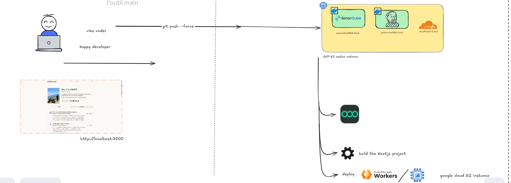

*Explication :* le développeur travaille localement sur l'application Next.js (`http://localhost:3000`) puis pousse son code sur GitHub. Une instance **Google Cloud E2 (medium)** héberge **SonarQube** (`sonar.khalidlab.tech`) et **Jenkins** (`jenkins.khalidlab.tech`) en conteneurs Docker, ainsi que le connecteur **cloudflared** qui les expose sur Internet. Jenkins compile le projet Next.js et le déploie sur **Cloudflare Workers** ; le schéma fait aussi apparaître **n8n**, dont l'URL de webhook est transmise à l'application lors du déploiement (voir [§ 7.3](#73-détail-de-létape-deploy)).

### 3.2 Flux d'analyse SAST

Le diagramme suivant décrit uniquement les composants et liaisons visibles dans les captures.

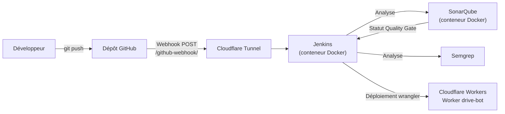

**Flux de données :**

1. Le développeur pousse un commit sur GitHub.
2. GitHub envoie une requête `POST` (JSON) à `https://jenkins.khalidlab.tech/github-webhook/`.
3. La requête traverse le **Cloudflare Tunnel** jusqu'au conteneur Jenkins : le tunnel est une connexion **sortante**, donc aucun port n'a besoin d'être ouvert en entrée sur le pare-feu de l'instance pour cela (voir la remarque sur les ports publiés au [§ 5.2](#52-provisionnement-avec-ansible)).
4. Jenkins récupère le code, installe les dépendances et lance l'analyse **SonarQube**.
5. L'étape **Quality Gate** attend le verdict calculé par SonarQube.
6. **Semgrep** analyse le code avec son jeu de règles.
7. Si toutes les étapes réussissent, l'application est déployée sur Cloudflare Workers.

### 3.3 Composants de l'infrastructure

| Composant | Détail observé | Source |
|---|---|---|
| Instance cloud | `notes`, Google Compute Engine, zone `us-central1-a`, x86_64 | Figure 2 |
| Système | Debian 13 « trixie » (image `debian-13-trixie-v20261014`), noyau 6.12.113 | Figures 2 et 3 |
| Provisionnement | Ansible 2.16.3, inventaire `inventory.ini`, `playbook.yml` | Figure 4, § 5.2 |
| Conteneurs | Docker ; Jenkins (`jenkins/jenkins:lts-jdk21`) ; SonarQube (`sonarqube:community`) | Playbook (§ 5.2) |
| Exposition | Cloudflare Tunnel `khalidlab-tunnel`, cloudflared 2026.10.1 | Figures 5 et 6 |
| SonarQube | Édition Community, projet `learn-actions` | Figures 8 et 9 |
| Application | Next.js en TypeScript (≈ 1,6 k lignes de code TypeScript, CSS…) | Figure 8 |
| Déploiement | Cloudflare Workers via wrangler 4.151.1, Worker `drive-bot` | Figure 10 |

---

## 4. Environnement et prérequis

### 4.1 Prérequis obligatoires

| Élément | Usage | Version observée |
|---|---|---|
| Compte Google Cloud | Instance qui héberge Jenkins et SonarQube | — |
| Ansible (poste de contrôle) | Installation de Docker et lancement des conteneurs | 2.16.3 |
| Accès SSH à l'instance | Exécution d'Ansible et administration | clé `ed25519`, utilisateur `sano` |
| Docker | Exécution de Jenkins et SonarQube | installé par le playbook (`docker-ce`, dépôt officiel Docker) |
| Jenkins | Orchestration du pipeline | image `jenkins/jenkins:lts-jdk21` |
| SonarQube | Analyse et Quality Gate | image `sonarqube:community` |
| Semgrep | Analyse par règles | non visible |
| Node.js | Build de l'application (outil Jenkins `node22`) | outil `node22` |
| Dépôt GitHub | Code source et webhook | — |

### 4.2 Prérequis optionnels (selon l'exposition et la cible de déploiement)

| Élément | Usage | Version observée |
|---|---|---|
| Domaine géré par Cloudflare | Sous-domaines `jenkins.` et `sonar.` | `khalidlab.tech` |
| cloudflared | Tunnel vers Jenkins et SonarQube | 2026.10.1 |
| Compte Cloudflare Workers + wrangler | Déploiement de l'application | wrangler 4.151.1 |

### 4.3 Vérifier l'environnement

Sur le poste de contrôle, la connectivité Ansible se vérifie avec le module `ping` (commande réellement exécutée, figure 4) :

```bash
ansible all -i inventory.ini -m ping
```

Réponse attendue : `SUCCESS` avec `"ping": "pong"` pour chaque hôte. Un `UNREACHABLE` indique un problème d'adresse, de clé SSH ou de pare-feu.

Sur l'instance, une fois provisionnée, les commandes usuelles suivantes permettent de contrôler les versions :

```bash
docker --version
docker ps            # les conteneurs jenkins et sonarqube doivent apparaître
cloudflared --version
```

---

## 5. Installation et configuration

### 5.1 Création de l'instance Google Cloud

**Figure 2 — Instance Compute Engine `notes`**

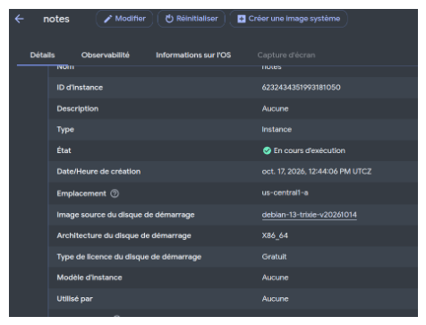

*Explication :* l'instance `notes` est **en cours d'exécution** dans la zone `us-central1-a`, avec l'image de démarrage `debian-13-trixie-v20261014` (x86_64). Elle a été créée le 17 octobre 2026. C'est elle qui héberge l'ensemble de la chaîne d'analyse.

**Figure 3 — Connexion SSH à l'instance**

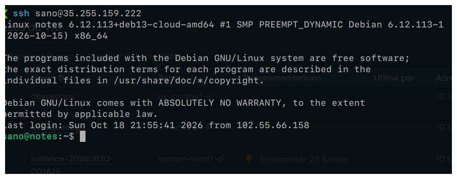

*Explication :* la connexion SSH avec l'utilisateur `sano` confirme que l'instance est joignable et tourne sous **Debian GNU/Linux** avec le noyau `6.12.113+deb13-cloud-amd64`. Cet accès est le préalable au provisionnement Ansible.

### 5.2 Provisionnement avec Ansible

Le projet Ansible contient deux fichiers : `inventory.ini` (les hôtes cibles) et `playbook.yml` (les tâches).

#### Inventaire : `inventory.ini`

```ini
[gcp]
<IP_PUBLIQUE_DE_L_INSTANCE> ansible_user=sano ansible_ssh_private_key_file=~/.ssh/id_ed25519 ansible_python_interpreter=/usr/bin/python3
```

- `[gcp]` est le groupe d'hôtes ciblé par le playbook (`hosts: gcp`) ;
- la connexion se fait en SSH avec l'utilisateur `sano` et une clé `ed25519` ;
- `ansible_python_interpreter` force l'usage de `python3`, présent par défaut sur Debian ;
- l'adresse IP publique est volontairement remplacée par un espace réservé dans ce document.

#### Playbook : `playbook.yml`

```yaml
---
- name: Install Docker, then run Jenkins and SonarQube as containers
  hosts: gcp
  become: true

  tasks:
    # ---------- Docker (installed on the VM) ----------
    - name: Install prerequisites
      apt:
        name: [ca-certificates, curl, gnupg]
        update_cache: true

    - name: Create keyrings directory
      file:
        path: /etc/apt/keyrings
        state: directory
        mode: "0755"

    - name: Add Docker GPG key
      get_url:
        url: https://download.docker.com/linux/debian/gpg
        dest: /etc/apt/keyrings/docker.asc
        mode: "0644"
        force: true

    - name: Add Docker repository
      apt_repository:
        repo: "deb [arch=amd64 signed-by=/etc/apt/keyrings/docker.asc] https://download.docker.com/linux/{{ ansible_distribution | lower }} {{ ansible_distribution_release }} stable"
        filename: docker

    - name: Install Docker
      apt:
        name:
          - docker-ce
          - docker-ce-cli
          - containerd.io
          - docker-buildx-plugin
          - docker-compose-plugin
          - python3-pip
        update_cache: true

    - name: Enable and start Docker
      service:
        name: docker
        state: started
        enabled: true

    - name: Install Docker Python SDK (for Ansible docker modules)
      pip:
        name: "docker>=7.1.0"
        extra_args: --break-system-packages

    - name: Add SSH user to docker group
      user:
        name: "{{ ansible_user }}"
        groups: docker
        append: true

    # ---------- Jenkins (container) ----------
    - name: Run Jenkins container
      community.docker.docker_container:
        name: jenkins
        image: jenkins/jenkins:lts-jdk21
        state: started
        restart_policy: unless-stopped
        user: root
        ports:
          - "8080:8080"
          - "50000:50000"
        volumes:
          - jenkins_home:/var/jenkins_home
          - /var/run/docker.sock:/var/run/docker.sock

    - name: Install Docker CLI inside the Jenkins container
      command: docker exec -u root jenkins sh -c "command -v docker || (apt-get update && (apt-get install -y docker-cli || apt-get install -y docker.io))"
      register: jenkins_docker_cli
      changed_when: "'Setting up' in jenkins_docker_cli.stdout"

    # ---------- SonarQube (container) ----------
    - name: Set vm.max_map_count for SonarQube
      sysctl:
        name: vm.max_map_count
        value: "262144"
        sysctl_set: true
        state: present

    - name: Set fs.file-max for SonarQube
      sysctl:
        name: fs.file-max
        value: "65536"
        sysctl_set: true
        state: present

    - name: Run SonarQube container
      community.docker.docker_container:
        name: sonarqube
        image: sonarqube:community
        state: started
        restart_policy: unless-stopped
        ports:
          - "9000:9000"
        volumes:
          - sonarqube_data:/opt/sonarqube/data
          - sonarqube_logs:/opt/sonarqube/logs
          - sonarqube_extensions:/opt/sonarqube/extensions
```

#### Ce que fait le playbook

| Bloc | Tâches | Rôle |
|---|---|---|
| **Docker (sur la VM)** | Prérequis, répertoire `/etc/apt/keyrings`, clé GPG et dépôt officiels Docker, installation de `docker-ce`, `docker-ce-cli`, `containerd.io`, des plugins `buildx` et `compose`, activation du service | Installer Docker depuis le dépôt officiel et le démarrer au boot |
| **SDK Python Docker** | `pip install "docker>=7.1.0"` (avec `--break-system-packages`) | Requis par les modules `community.docker` ; l'option est nécessaire sur Debian 13, dont le Python système est protégé (PEP 668) |
| **Groupe `docker`** | Ajout de l'utilisateur SSH au groupe `docker` | Permettre d'utiliser `docker` sans `sudo` (effectif à la prochaine connexion) |
| **Jenkins** | Conteneur `jenkins/jenkins:lts-jdk21`, ports `8080` (interface web) et `50000` (agents), volume `jenkins_home`, socket Docker monté | Orchestrateur CI/CD, données persistantes, accès au démon Docker de l'hôte |
| **Docker CLI dans Jenkins** | `docker exec` qui installe `docker-cli` (ou `docker.io`) si `docker` est absent | Permettre au pipeline de lancer des commandes Docker (par exemple pour exécuter Semgrep en conteneur) |
| **Paramètres noyau** | `vm.max_map_count = 262144`, `fs.file-max = 65536` | Prérequis de SonarQube (moteur de recherche embarqué), persistés par `sysctl` |
| **SonarQube** | Conteneur `sonarqube:community`, port `9000`, trois volumes (`data`, `logs`, `extensions`) | Serveur d'analyse avec données conservées au redémarrage |

Les deux conteneurs utilisent `restart_policy: unless-stopped` : ils redémarrent automatiquement après un reboot de l'instance, sauf s'ils ont été arrêtés volontairement.

#### Lancer le provisionnement

```bash
ansible all -i inventory.ini -m ping             # 1. tester la connexion
ansible-playbook -i inventory.ini playbook.yml   # 2. appliquer le playbook
```

**Figure 4 — Test de connectivité et exécution du playbook**

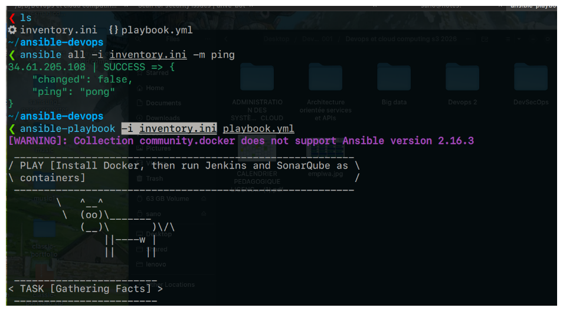

*Explication :* le `ping` Ansible renvoie `SUCCESS` / `pong`. Le playbook démarre ensuite la play **« Install Docker, then run Jenkins and SonarQube as containers »** : il installe Docker puis lance Jenkins et SonarQube en conteneurs. Un avertissement indique que la collection `community.docker` ne prend pas officiellement en charge **Ansible 2.16.3** ; il n'a pas empêché l'exécution visible ici, mais il signale un risque de compatibilité à corriger (voir [§ 9](#9-limites-et-recommandations)). La capture s'arrête à la tâche *Gathering Facts* : le récapitulatif final (`PLAY RECAP`) n'y figure pas.

> **Intérêt de l'approche :** l'infrastructure est décrite sous forme de code ; elle peut être reconstruite à l'identique sur une nouvelle instance.

#### Points d'attention sur ce playbook

- **Ports publiés sur toutes les interfaces.** Les mappings `"8080:8080"`, `"50000:50000"` et `"9000:9000"` exposent les services sur toutes les interfaces de la VM. Comme l'accès public passe par le Cloudflare Tunnel, il suffit de ne pas ouvrir ces ports dans le pare-feu GCP, ou de les lier à la boucle locale (`"127.0.0.1:8080:8080"`).
- **Socket Docker monté dans Jenkins, conteneur en `root`.** C'est pratique (le pipeline peut piloter Docker) mais cela donne à Jenkins un contrôle équivalent à `root` sur l'hôte. Acceptable pour un workshop, à éviter en production.
- **Tag `lts-jdk21` et `sonarqube:community`.** Ce sont des tags **mobiles** : une réexécution du playbook peut tirer une version plus récente. Pour un environnement reproductible, fixer un tag précis.
- **Tâche `docker exec`.** Elle passe par `command` : l'idempotence repose sur `command -v docker` et sur `changed_when`, pas sur un module Ansible dédié.
- **Compatibilité.** L'avertissement `community.docker` / Ansible 2.16.3 vu en figure 4 est à traiter en alignant les versions.

### 5.3 Exposition de Jenkins et SonarQube via Cloudflare Tunnel

Plutôt que d'ouvrir les ports de Jenkins et SonarQube sur Internet, l'équipe a utilisé un **Cloudflare Tunnel** : le connecteur `cloudflared`, installé sur l'instance, établit une connexion **sortante** vers Cloudflare, qui publie ensuite `jenkins.khalidlab.tech` et `sonar.khalidlab.tech` en HTTPS.

```bash
cloudflared tunnel login                  # authentification auprès de Cloudflare
cloudflared tunnel run khalidlab-tunnel   # démarrage du tunnel
```

**Figure 5 — Authentification de cloudflared**

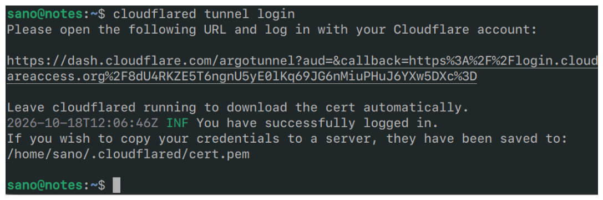

*Explication :* après validation dans le navigateur, `cloudflared` confirme la connexion et enregistre le certificat d'origine dans `/home/sano/.cloudflared/cert.pem`. Ce fichier donne le droit de gérer les tunnels du compte : il ne doit **jamais** être versionné ni partagé.

**Figure 6 — Démarrage du tunnel `khalidlab-tunnel`**

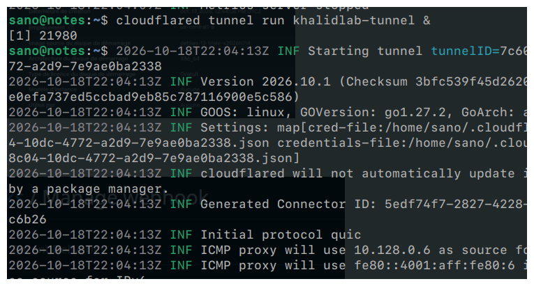

*Explication :* le tunnel démarre (cloudflared **2026.10.1**, Go 1.27.2, linux), lit son fichier d'identifiants, génère un identifiant de connecteur et utilise le protocole **QUIC**. Le tunnel est ici lancé en arrière-plan avec `&` ; pour un fonctionnement durable (redémarrage de l'instance), il est préférable de l'installer comme service système.

### 5.4 Configuration du webhook GitHub

Dans le dépôt GitHub : **Settings → Webhooks → Add webhook**.

**Figure 7 — Webhook GitHub vers Jenkins**

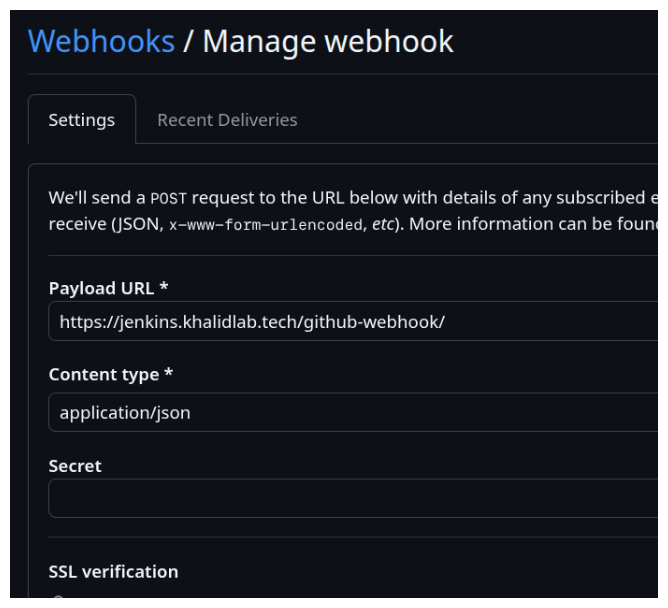

*Explication :* GitHub envoie un `POST` au format `application/json` vers `https://jenkins.khalidlab.tech/github-webhook/`, point d'entrée du plugin GitHub de Jenkins. C'est ce webhook qui déclenche le pipeline à chaque push (la figure 10 confirme un build *« Started by GitHub push »*). Le champ **Secret** est vide : la signature des requêtes n'est donc pas vérifiée (voir [§ 9.3](#93-recommandations-pour-ce-projet)).

### 5.5 Configuration de Jenkins et gestion des secrets

D'après la figure 10, le job Jenkins utilise :

- un outil Node.js déclaré sous le nom **`node22`** (*Global Tool Configuration*) ;
- une intégration **SonarQube** (analyse puis attente de la Quality Gate) ;
- un identifiant **`N8N_WEBHOOK_URL`** stocké dans Jenkins et masqué dans les journaux (`****`).

Les secrets ne doivent jamais apparaître dans le code ni dans ce README. Ils sont stockés dans **Manage Jenkins → Credentials** puis injectés dans le pipeline sous forme de variables d'environnement, par exemple `${SONAR_TOKEN}` pour le jeton SonarQube ou les identifiants Cloudflare nécessaires à wrangler. Jenkins masque automatiquement leur valeur dans la console, comme le montre la figure 10.

---

## 6. Analyse SonarQube

### 6.1 Rôle et intégration

SonarQube analyse le code transmis par le scanner, calcule des indicateurs par **qualité logicielle** et évalue la **Quality Gate**. Dans le pipeline, l'étape *SonarQube Analysis* envoie l'analyse au serveur `sonar.khalidlab.tech`, puis l'étape *Quality Gate* attend le verdict. Le projet est enregistré dans SonarQube sous la clé **`learn-actions`**.

### 6.2 Tableau de bord du projet

**Figure 8 — Vue synthétique du projet `learn-actions`**

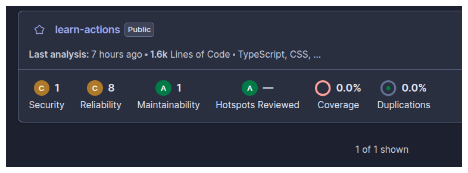

*Explication :* dernière analyse il y a 7 heures au moment de la capture, sur environ **1,6 k lignes de code** (TypeScript, CSS…).

| Qualité logicielle | Note | Nombre de problèmes | Lecture |
|---|---|---|---|
| Security | **C** | 1 | Un problème de sécurité ouvert (détaillé en 6.3) |
| Reliability | **C** | 8 | Défauts de fiabilité (gestion des promesses) |
| Maintainability | **A** | 1 | Un problème de maintenabilité mineur |
| Security Hotspots revus | **A** | — | Aucun hotspot en attente de revue |
| Couverture | — | 0,0 % | Aucun rapport de tests transmis à SonarQube |
| Duplications | — | 0,0 % | Pas de code dupliqué détecté |

> **Note sur le nombre de problèmes.** La vue *Issues* de la figure 9 affiche **9 issues** pour `app/page.tsx` (filtre sur les statuts *Open* et *Confirmed*), chiffre cohérent avec le résultat rapporté pour le workshop. La carte projet totalise 1 + 8 + 1 = 10 problèmes : un même problème pouvant être rattaché à plusieurs qualités logicielles, ou un problème pouvant se trouver dans un autre fichier, les deux vues ne se comparent pas directement. Les captures ne permettent pas de trancher.

### 6.3 Détail d'un problème de sécurité : règle `typescript:S2245`

**Figure 9 — Problème de sécurité sur le générateur pseudo-aléatoire**

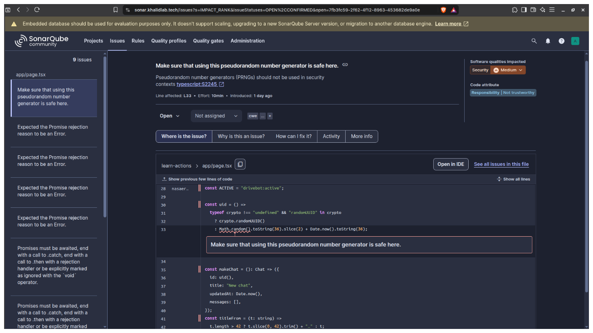

*Explication :* SonarQube signale, ligne 33 de `app/page.tsx`, l'usage de `Math.random()` dans la fonction `uid()` (règle **`typescript:S2245`**, impact **Security / Medium**, effort estimé 10 min). Le code utilise `crypto.randomUUID()` lorsqu'il est disponible et ne retombe sur `Math.random()` + `Date.now()` qu'en solution de repli. Les identifiants générés servent à identifier des conversations (`makeChat`).

**Interprétation :** `Math.random()` n'est pas un générateur cryptographiquement sûr : ses valeurs sont prévisibles. Le risque n'existe que si l'identifiant joue un rôle de sécurité (jeton de session, secret, lien non devinable). S'il s'agit seulement d'une clé d'affichage locale, le problème peut être revu et accepté avec justification ; sinon, il faut corriger. La correction recommandée est d'utiliser l'API Web Crypto aussi dans le repli, par exemple `crypto.getRandomValues()`.

### 6.4 Problèmes de fiabilité visibles

La liste latérale de la figure 9 montre deux familles de problèmes de fiabilité dans `app/page.tsx` :

| Message SonarQube | Signification | Correction recommandée |
|---|---|---|
| *Expected the Promise rejection reason to be an Error* | Une promesse est rejetée avec une valeur qui n'est pas un objet `Error` : on perd la pile d'appels et le type d'erreur | Rejeter avec `new Error("…")` |
| *Promises must be awaited, end with a call to .catch, … or be explicitly marked as ignored with the `void` operator* | Une promesse est lancée sans que son échec soit traité : une erreur peut passer inaperçue | Ajouter `await`, un `.catch(...)`, ou `void` si l'ignorer est volontaire |

Ces problèmes relèvent de la **fiabilité** et non directement de la sécurité ; ils peuvent néanmoins masquer des erreurs à l'exécution. Il serait inexact de présenter les 9 issues comme 9 vulnérabilités : **une seule** est classée *Security* dans les captures.

### 6.5 Quality Gate

Dans le build #9 (figure 10), l'étape **Quality Gate** se termine en succès (21 s) et le pipeline poursuit jusqu'au déploiement : la Quality Gate est donc **passée**, malgré les problèmes ouverts. Cela signifie que les conditions de la Quality Gate configurée n'étaient pas enfreintes (la Quality Gate par défaut de SonarQube porte principalement sur le **nouveau code**). La définition exacte des conditions utilisées n'apparaît pas dans les captures.

### 6.6 Avertissement : base de données embarquée

La bannière de la figure 9 indique que SonarQube utilise sa **base de données embarquée**, prévue uniquement pour l'évaluation : elle ne permet ni la montée en charge, ni la mise à jour vers une nouvelle version de SonarQube, ni la migration vers un autre moteur. C'est cohérent avec le playbook, qui lance `sonarqube:community` sans base externe ; c'est acceptable pour un workshop, mais une base PostgreSQL serait nécessaire pour un usage durable.

---

## 7. Analyse Semgrep et pipeline Jenkins

### 7.1 Analyse Semgrep

**Rôle :** Semgrep analyse le code en le comparant à des **règles** décrivant des motifs dangereux (par exemple un appel à `eval` sur une entrée utilisateur). Les règles sont exprimées dans une syntaxe proche du code analysé, ce qui les rend faciles à lire et à adapter.

**Exécution dans le pipeline :** l'étape **Semgrep** du build #9 s'est terminée en succès en **15 s** (figure 10).

**Résultat rapporté :**

| Indicateur | Valeur | Statut de la preuve |
|---|---|---|
| Règles exécutées | 214 | Rapporté dans la description du workshop |
| Fichiers analysés | 26 | Rapporté dans la description du workshop |
| Findings | 0 | Rapporté dans la description du workshop |
| Étape Jenkins *Semgrep* | Succès, 15 s | **Visible** (figure 10) |

> Aucune capture de la sortie de Semgrep n'est disponible : le détail des 214 règles, des 26 fichiers et des 0 findings n'a donc pas pu être vérifié visuellement. Le jeu de règles exact utilisé n'est pas visible non plus.

**Interprétation d'un résultat à zéro finding :** cela signifie qu'**aucune des règles exécutées** n'a trouvé de correspondance dans les fichiers analysés. Cela ne signifie **pas** que l'application est sans vulnérabilité : la couverture dépend entièrement du jeu de règles. On remarque d'ailleurs que l'usage de `Math.random()` relevé par SonarQube n'a pas été signalé par Semgrep, ce qui illustre la complémentarité des deux outils.

Pour reproduire une analyse, la commande standard de Semgrep est la suivante (à adapter au jeu de règles réellement retenu) :

```bash
semgrep scan --config auto --error
```

L'option `--error` fait échouer la commande lorsqu'un finding est trouvé, ce qui permet à Jenkins d'arrêter le pipeline.

### 7.2 Pipeline Jenkins

**Figure 10 — Exécution réussie du build #9 du job `notes`**

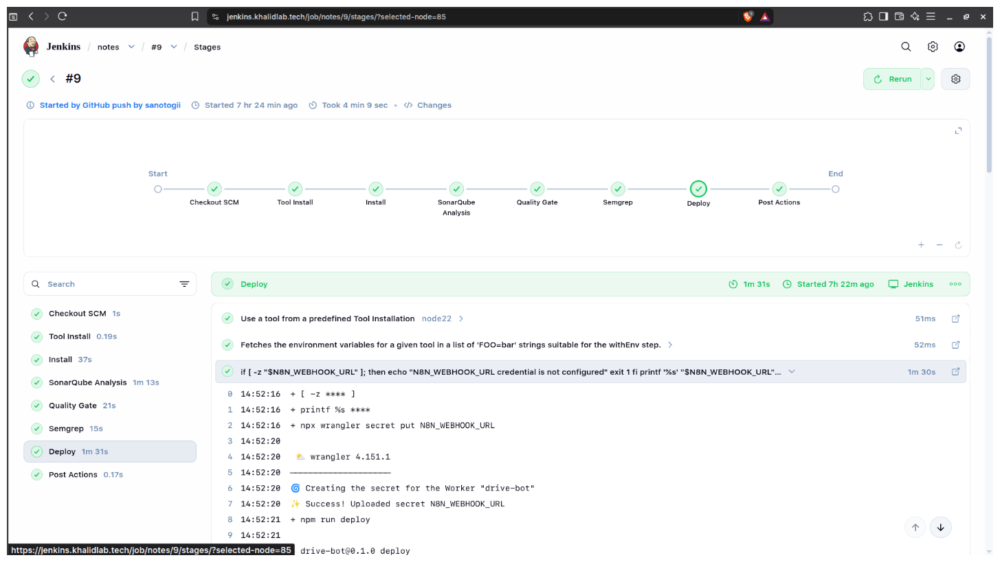

*Explication :* le build **#9** a été **déclenché par un push GitHub** de l'utilisateur `sanotogii` et a duré **4 min 9 s**. Toutes les étapes sont **vertes** :

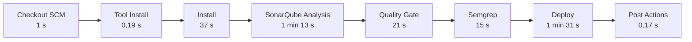

| Étape | Durée | Rôle |
|---|---|---|
| Checkout SCM | 1 s | Récupération du code depuis GitHub |
| Tool Install | 0,19 s | Mise à disposition de Node.js (`node22`) |
| Install | 37 s | Installation des dépendances npm |
| SonarQube Analysis | 1 min 13 s | Envoi de l'analyse au serveur SonarQube |
| Quality Gate | 21 s | Attente et vérification du verdict SonarQube |
| Semgrep | 15 s | Analyse par règles |
| Deploy | 1 min 31 s | Déploiement sur Cloudflare Workers |
| Post Actions | 0,17 s | Actions de fin de pipeline |

L'ordre des étapes place les **contrôles de sécurité avant le déploiement** : un échec de l'une d'elles empêche la mise en production.

### 7.3 Détail de l'étape Deploy

La console de l'étape *Deploy* (figure 10) montre la séquence suivante :

1. sélection de l'outil `node22` et chargement de son environnement ;
2. contrôle de présence du secret : si `N8N_WEBHOOK_URL` est vide, le pipeline affiche *« N8N_WEBHOOK_URL credential is not configured »* et s'arrête (`exit 1`) ;
3. `npx wrangler secret put N8N_WEBHOOK_URL` : le secret est transmis au Worker **`drive-bot`** (*Success! Uploaded secret N8N_WEBHOOK_URL*) ;
4. `npm run deploy` : construction et déploiement de l'application.

La valeur du secret apparaît masquée (`****`) dans le journal : elle n'est jamais écrite en clair.

### 7.4 Comportement en cas d'échec

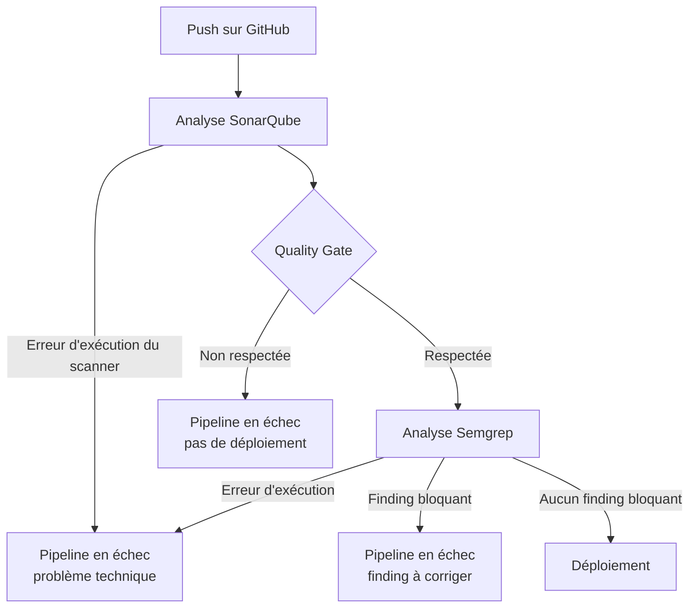

Il faut distinguer deux situations :

- **Erreur d'exécution** (serveur SonarQube injoignable, jeton invalide, Semgrep non installé) : c'est un problème d'outillage, pas de sécurité. Le code n'a pas été évalué.
- **Résultat de sécurité** (Quality Gate non respectée, finding Semgrep bloquant) : l'outil a fonctionné et a trouvé un problème dans le code. Il faut corriger, ou justifier explicitement l'acceptation du risque.

Le comportement exact (bloquant ou non) dépend de la configuration du `Jenkinsfile` et de Semgrep, qui ne figure pas dans les éléments disponibles. Ce schéma décrit le comportement visé par l'intégration.

---

## 8. Résultats et comparaison

### 8.1 Synthèse

| Outil | Résultat observé | Action menée | Statut final |
|---|---|---|---|
| SonarQube | 9 issues sur `app/page.tsx` ; carte projet : Security C (1), Reliability C (8), Maintainability A (1) | Aucune correction documentée | Problèmes toujours ouverts au moment des captures |
| Quality Gate | Étape en succès (21 s) | — | **Passée** (build #9) |
| Semgrep | 214 règles, 26 fichiers, 0 finding (**rapporté**) | Aucune correction nécessaire | Étape en succès (15 s) |
| Jenkins | Build #9 déclenché par push GitHub | — | **Toutes les étapes vertes**, 4 min 9 s |

### 8.2 Problèmes SonarQube identifiés

| Fichier | Règle / message | Qualité | Sévérité | Cause | Correction recommandée | Retest |
|---|---|---|---|---|---|---|
| `app/page.tsx` L33 | `typescript:S2245` — PRNG non sûr | Security | Medium | `Math.random()` en repli de `crypto.randomUUID()` | `crypto.getRandomValues()`, ou revue justifiée si non sensible | Non effectué |
| `app/page.tsx` | *Expected the Promise rejection reason to be an Error* | Reliability | non visible | Rejet de promesse sans objet `Error` | `reject(new Error(...))` | Non effectué |
| `app/page.tsx` | *Promises must be awaited…* | Reliability | non visible | Promesse non attendue ni traitée | `await`, `.catch()` ou `void` | Non effectué |

Les captures n'affichent pas les 9 issues individuellement ; seules ces trois familles sont visibles.

### 8.3 Comparaison des deux outils sur ce projet

| Critère | SonarQube | Semgrep |
|---|---|---|
| Problèmes signalés | 9 sur `app/page.tsx` | 0 (rapporté) |
| Dont sécurité | 1 (S2245) | 0 |
| Couverture qualité (fiabilité, maintenabilité) | Oui | Non (jeu de règles de sécurité) |
| Bloque le pipeline | Via la Quality Gate | Selon la configuration de l'étape |
| Durée dans le pipeline | 1 min 13 s + 21 s | 15 s |

Le fait que SonarQube signale l'usage de `Math.random()` alors que Semgrep ne remonte rien montre concrètement que **les deux outils ne voient pas les mêmes choses**.

---

## 9. Limites et recommandations

### 9.1 Limites du SAST

- **Faux positifs** : un problème signalé n'est pas forcément exploitable (exemple : S2245 si l'identifiant n'a aucun rôle de sécurité). Chaque résultat demande une revue humaine.
- **Faux négatifs** : un outil ne trouve que ce que ses règles décrivent. Zéro finding ne signifie pas zéro vulnérabilité.
- **Pas d'exécution** : l'analyse statique ne voit ni la configuration réelle en production, ni les comportements à l'exécution, ni les failles de logique métier.
- **Dépendances non couvertes** : les vulnérabilités des bibliothèques npm relèvent de l'analyse de composition (**SCA**), par exemple `npm audit`.

### 9.2 Limites propres à ce workshop

- La **Quality Gate est passée alors que des problèmes restent ouverts** : une Quality Gate passée ne prouve pas que l'application est sûre, seulement qu'elle respecte les conditions configurées.
- La **couverture de tests est de 0 %** : aucune métrique de test n'alimente l'analyse.
- SonarQube utilise la **base de données embarquée**, non adaptée à un usage durable.
- Le résultat **Semgrep n'est pas illustré** par une capture de sa sortie.
- **Aucune correction ni nouvelle analyse** n'est documentée après la détection des problèmes.
- La compatibilité **`community.docker` / Ansible 2.16.3** est signalée comme non supportée.
- **Jenkins tourne en `root` avec le socket Docker monté** et les ports `8080`, `50000` et `9000` sont publiés sur toutes les interfaces de la VM (voir [§ 5.2](#52-provisionnement-avec-ansible)).
- Les **images Docker utilisent des tags mobiles** (`lts-jdk21`, `community`) : l'environnement n'est pas strictement reproductible dans le temps.

### 9.3 Recommandations pour ce projet

1. **Définir un secret sur le webhook GitHub** et le renseigner dans Jenkins, afin que seules les requêtes signées par GitHub déclenchent un build.
2. **Corriger S2245** avec `crypto.getRandomValues()`, ou marquer le problème comme revu en documentant pourquoi il est sans risque.
3. **Corriger les problèmes de fiabilité** sur les promesses, puis relancer le pipeline pour vérifier leur disparition.
4. **Renforcer la Quality Gate**, par exemple en exigeant une note de sécurité A.
5. **Rendre Semgrep bloquant** (`--error`) et **publier son rapport** (format SARIF ou JSON) comme artefact Jenkins.
6. **Ajouter une analyse des dépendances** (`npm audit` ou équivalent) et, à terme, des tests dynamiques (**DAST**).
7. **Migrer SonarQube vers PostgreSQL** et **installer cloudflared comme service** plutôt qu'en arrière-plan.
8. **Aligner les versions** d'Ansible et de la collection `community.docker`.
9. **Lier les ports publiés à `127.0.0.1`** dans le playbook (`"127.0.0.1:8080:8080"`, `"127.0.0.1:9000:9000"`) et **fixer des tags d'image précis** pour Jenkins et SonarQube.
10. **Masquer les adresses IP publiques** visibles dans les captures avant une publication large du dépôt.

---

## 10. Conclusion

Ce workshop a permis de construire une chaîne SAST complète et automatisée. L'infrastructure a été provisionnée **sous forme de code** avec Ansible (un inventaire et un playbook qui installent Docker puis lancent Jenkins et SonarQube) sur une instance Google Cloud ; Jenkins et SonarQube y tournent en conteneurs Docker et sont exposés de manière sécurisée par un **Cloudflare Tunnel**. Un **webhook GitHub** déclenche le pipeline à chaque push, et Jenkins enchaîne installation, **analyse SonarQube**, **Quality Gate**, **analyse Semgrep** et **déploiement** sur Cloudflare Workers.

Les résultats mesurés montrent la **complémentarité des deux outils** : SonarQube a relevé 9 problèmes dans `app/page.tsx`, dont un problème de sécurité (générateur pseudo-aléatoire non cryptographique) et plusieurs problèmes de fiabilité liés aux promesses, tandis que Semgrep n'a rapporté aucun finding avec ses 214 règles. Le build #9 s'est terminé avec **toutes les étapes au vert** et une Quality Gate passée.

Ce succès doit cependant être lu avec recul : les problèmes détectés n'ont pas encore été corrigés ni retestés, et une Quality Gate passée ou un scan à zéro finding ne garantissent pas l'absence de vulnérabilité. Les prochaines étapes naturelles sont la correction des problèmes identifiés, le durcissement de la Quality Gate, du webhook et de la configuration Docker, puis l'ajout d'analyses complémentaires (dépendances, tests dynamiques) pour couvrir ce que le SAST ne voit pas.

---

## 11. Références

- SonarQube — documentation officielle : https://docs.sonarsource.com/sonarqube-server/
- SonarQube — Quality Gates : https://docs.sonarsource.com/sonarqube-server/latest/instance-administration/analysis-functions/quality-gates/
- SonarQube — intégration Jenkins : https://docs.sonarsource.com/sonarqube-server/latest/analyzing-source-code/ci-integration/jenkins-integration/global-setup/
- Règle SonarQube S2245 (PRNG) : https://rules.sonarsource.com/typescript/RSPEC-2245/
- Semgrep — documentation : https://semgrep.dev/docs/
- Semgrep — référence CLI : https://semgrep.dev/docs/cli-reference
- Jenkins — Pipeline : https://www.jenkins.io/doc/book/pipeline/
- Jenkins — gestion des credentials : https://www.jenkins.io/doc/book/using/using-credentials/
- GitHub — webhooks : https://docs.github.com/en/webhooks
- GitHub — validation des livraisons de webhook : https://docs.github.com/en/webhooks/using-webhooks/validating-webhook-deliveries
- Ansible — documentation : https://docs.ansible.com/
- Ansible — collection `community.docker` : https://docs.ansible.com/ansible/latest/collections/community/docker/
- Docker — installation sur Debian : https://docs.docker.com/engine/install/debian/
- SonarQube — prérequis système (`vm.max_map_count`) : https://docs.sonarsource.com/sonarqube-server/latest/setup-and-upgrade/pre-installation/linux/
- Cloudflare Tunnel : https://developers.cloudflare.com/cloudflare-one/connections/connect-networks/
- Cloudflare Workers — wrangler : https://developers.cloudflare.com/workers/wrangler/
- OWASP — Static Code Analysis : https://owasp.org/www-community/controls/Static_Code_Analysis
- Diagrammes Mermaid sur GitHub : https://docs.github.com/en/get-started/writing-on-github/working-with-advanced-formatting/creating-diagrams
